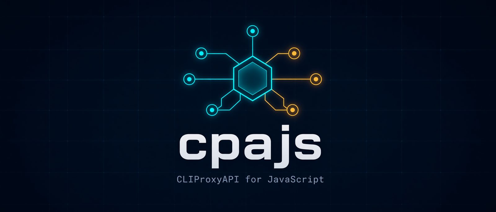

<p align="center">
  
</p>

<p align="center">
  <b>Run <a href="https://github.com/router-for-me/CLIProxyAPI">CLIProxyAPI</a> from Node.js or Bun, and manage it with a typed client.</b><br>
  <code>npm install</code> gets you the binary. No Go, no Docker, no download script.
</p>

<p align="center">
  <a href="https://www.npmjs.com/package/@cpajs/cpa"></a>
  <a href="https://www.npmjs.com/package/@cpajs/codex-auth"></a>
  
  
  = 22">
  <a href="#license"></a>
</p>

---

[CLIProxyAPI](https://github.com/router-for-me/CLIProxyAPI) (CPA) turns your Codex, Claude Code, Gemini CLI and
other subscriptions into one OpenAI-compatible endpoint. **cpajs** makes it a regular dependency of your
JavaScript app: start it, point any OpenAI SDK at it, manage accounts and config through a typed API, and stop it.

## Highlights

- **Batteries included.** The official CPA binary for 23 platforms ships through `optionalDependencies`, built
  from pinned source and verified in CI.
- **One call to a running server.** `startServer()` writes the config, picks a free port, waits for `/healthz`,
  streams parsed logs, and gives you `baseUrl` for your OpenAI client.
- **No orphan processes.** CPA exits with your process, even after `SIGKILL`, a crash or a `tsx watch` reload.
- **Typed management client.** Covers every route of the v8 management API: config with ETags, credentials,
  OAuth, logs, usage and more. Types are derived from the CPA source. Works against local and remote instances.
- **Safe by default.** The management key is generated per start, only its bcrypt hash reaches disk, and remote
  management stays off unless you turn it on.
- **Sign in with ChatGPT.** `@cpajs/codex-auth` runs the Codex device flow and uploads the result to CPA, with
  zero dependencies.

## Quick start

```sh
npm install @cpajs/cpa@rc openai
```

```ts
import OpenAI from 'openai';
import { startServer } from '@cpajs/cpa/server';

const server = await startServer({
  stateDir: './.cpa', // keeps config and credentials between runs
  config: { access: { 'api-keys': ['sk-local'] } },
});

const openai = new OpenAI({ baseURL: server.baseUrl, apiKey: 'sk-local' });
console.log(await openai.models.list());

await server.stop();
```

Before models show up, CPA needs at least one account. Add it with the management client (OAuth, file upload),
the bundled web control panel, or the ChatGPT device flow below.

### Sign in with ChatGPT

```sh
npm install @cpajs/codex-auth@rc
```

```ts
import { loginAndUpload } from '@cpajs/codex-auth/cpa';

const { email, planType } = await loginAndUpload(server.client(), {
  onCode: ({ userCode, verificationUrl }) => console.log(`Open ${verificationUrl} and enter ${userCode}`),
});
console.log(`Signed in as ${email} (${planType})`);
```

### Manage any CPA instance

```ts
import { createClient } from '@cpajs/cpa/client';

const client = createClient({
  baseUrl: 'https://cpa.example.com',
  managementKey: process.env.CPA_MANAGEMENT_KEY!,
});

const { files } = await client.credentials.list();
await client.config.set('routing/strategy', 'round-robin'); // value typed by path

const login = await client.oauth.start({ provider: 'claude' });
console.log('open', login.url);
await client.oauth.waitForCompletion(login.state);
```

## Packages

| Package | What it does |
| --- | --- |
| [`@cpajs/cpa`](packages/cpa) | Server lifecycle (`/server`), typed management client (`/client`), bundler entry (`/binary`). |
| [`@cpajs/codex-auth`](packages/codex-auth) | Codex device flow, id_token parsing, and the auth file CPA reads. Zero runtime dependencies. |
| `@cpajs/<os>-<arch>` | Prebuilt CPA binaries, installed automatically for your platform. See [docs/platform-packages.md](docs/platform-packages.md). |

All packages share one version and are released together. `latest` still points at an early alpha, so install
with the `rc` tag for now.

## Platforms

| OS | Architectures |
| --- | --- |
| macOS | x64, arm64 |
| Windows | x64, arm64, ia32 |
| Linux (glibc and musl) | x64, arm64 |
| Linux | arm (ARMv7+), ia32, riscv64, ppc64le, s390x, loong64, mips, mipsel |
| FreeBSD | x64, arm64, ia32 |
| OpenBSD / NetBSD | x64, arm64 / x64 |

Build flavours and how each target is verified are listed in [compatibility.md](packages/cpa/docs/compatibility.md#platforms).

## Documentation

- [`@cpajs/cpa` README](packages/cpa/README.md): every server option, the client, bundling and deploying
- [`@cpajs/codex-auth` README](packages/codex-auth/README.md): device flow primitives, tokens, auth files
- [Management API coverage](packages/cpa/docs/api-coverage.md)
- [Compatibility and versioning](packages/cpa/docs/compatibility.md)
- [Migration guide](packages/cpa/docs/migration.md) and [changelog](packages/cpa/CHANGELOG.md)
- [Scope](packages/cpa/docs/scope.md): what cpajs does and deliberately does not do

## Development

<details>
<summary>Working on cpajs itself</summary>

pnpm monorepo; every directory in `packages/*` is a workspace member. The platform packages are generated in
`dist-npm/` and are not workspace members. `scripts/` holds build, assemble, pack and publish tooling,
`launcher/` the Go `cpa-launcher` shipped in the platform packages.

```sh
pnpm install
pnpm lint                  # Biome, whole repo
pnpm typecheck             # every package (scripts/ is checked as part of packages/cpa)
pnpm test                  # unit tests of every package
pnpm build                 # pnpm -r build
node scripts/build-binary.ts --target linux-x64-musl            # → dist-bin/
CPA_BINARY=$PWD/dist-bin/linux-x64-musl/cli-proxy-api pnpm test:e2e   # contract tests against real CPA
```

Package-level commands also work inside `packages/cpa` (for example `pnpm test:coverage`). The release scripts
are run from the repository root and are described in [packages/cpa/README.md](packages/cpa/README.md#development).
`pnpm panel:fetch` writes the bundled panel to `packages/cpa/assets/management.html`.

Releasing, and adding a new package to the release, is covered in [docs/releasing.md](docs/releasing.md).
To add a package, create `packages/<name>/` with its own `package.json`; `pnpm-workspace.yaml` already matches
`packages/*`.

</details>

## License

MIT. The bundled CLIProxyAPI binaries are MIT licensed by their authors; each platform package ships their LICENSE.
